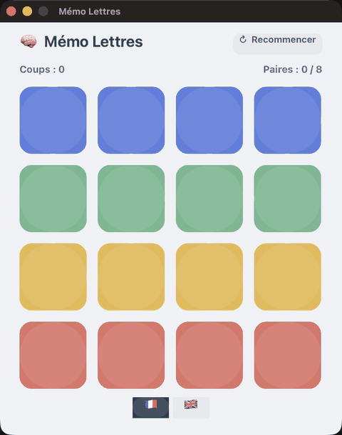

# LetterMemory

**A memory game that pairs a letter with its picture.** Flip two cards; a match is a **letter**
and the **picture whose name starts with it** (like [LetterDetective](https://github.com/mesopelagique/LetterDetective),
but from memory). Bilingual 🇫🇷 / 🇬🇧. Built on [Hero](https://github.com/mesopelagique/Hero) (`cs.hero`).

## Play

Open the project — `On Startup` deals the board. Tap two cards to turn them over:

- a **letter** card and a **picture** card match when the picture's name starts with that letter
  (e.g. **L** ↔ 🦁 *lion*, **P** ↔ 🍎 *pomme*);
- matched cards stay up, a mismatch turns back — find all eight pairs.
- Switch **🇫🇷 / 🇬🇧** at the bottom to change the pictures' names (and so the letters); **↻ Recommencer**
  deals a fresh board.

## How it's built

Straight from [Memory4D](https://github.com/mesopelagique/Memory4D): the flip is a matched-geometry
move by hand — the back squishes to a zero-width sliver, the face takes its place and opens out,
two chained `cs.hero` tweens on one rectangle (`easeInQuad` closes, `easeOutQuad` opens). The
twist here is the deck: a pair is a letter card and a picture card sharing a pair id, so a turn
matches when the two ids agree — one letter meeting one picture, never two identical cards. The
pictures are dealt with distinct starting letters so each letter has exactly one answer.

## `cs.LetterMemory`

| Function | Action |
|:-|:-|
| `.reset()` | Deal eight letter/picture pairs with distinct letters, shuffled face-down. |
| `.pick($k)` | Flip card `$k` (0-based); the second flip resolves the turn. |
| `.selectLang($i)` | Language — `1` = Français, else English (re-deals with new names). |
